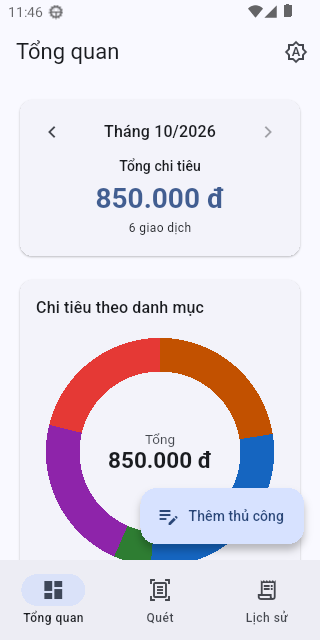
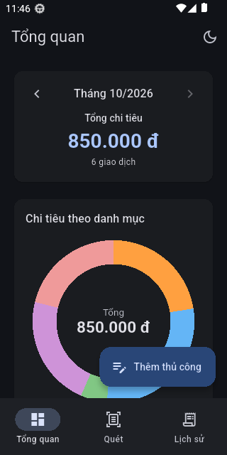
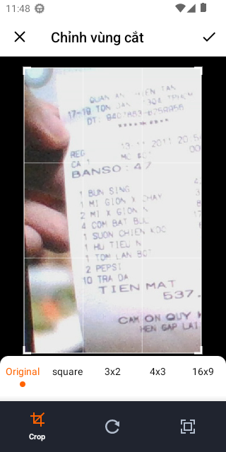
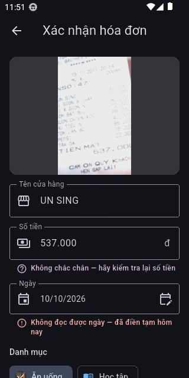
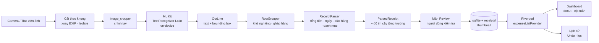

# VKU Expense OCR

Ứng dụng Flutter quản lý chi tiêu cá nhân: **chụp hóa đơn giấy**, nhận dạng chữ **on-device (offline)** bằng Google ML Kit, tự tách **tổng tiền / ngày / tên cửa hàng** bằng bộ phân tích heuristic regex, cho người dùng **kiểm tra lại** trước khi lưu, lưu cục bộ bằng `sqflite` và trực quan hóa chi tiêu bằng biểu đồ **vẽ tay bằng `CustomPainter`** (donut theo danh mục, cột theo tuần).

> Mini-Project 3 — môn *Cross-Platform Mobile App Development*, Khoa Khoa học Máy tính, Trường ĐH CNTT & TT Việt – Hàn (VKU).

## Tác giả

| | |
|---|---|
| Họ tên | **Lê Duy Đạt** |
| MSSV | 23IT048 |
| Lớp | 23SE1 |
| GitHub | [lddatitvku0202](https://github.com/lddatitvku0202) |

## Trạng thái hiện tại

| Hạng mục | Trạng thái |
|---|---|
| Mã nguồn, kiểm thử trên máy tính | ✅ 717 test, 94,5% độ phủ dòng, `flutter analyze` 0 issue |
| APK release đã ký | ✅ Đã build và ký (xem [Build](#build-apk-release)); cài và chạy được trên **emulator** |
| Chạy trên **điện thoại Android thật** | ⚠ **Chưa**. Các mục "chưa xác minh trên máy thật" bên dưới còn nợ |
| Video demo, báo cáo PDF, link APK | ⏳ Chưa làm (Phase 11B) |

## Tính năng

Chú thích: ✅ có test tự động trên máy tính · 🟦 đã chạy thử bản release trên emulator · ⚠ **chưa xác minh trên điện thoại thật**.

### FR-1. Chụp ảnh và cắt ảnh

> Chưa đánh dấu hoàn tất: **code và test trên máy tính đã xong, nhưng chưa xác minh trên điện thoại thật** (theo quy ước của dự án).

- [ ] FR-1.1 Camera sau với preview trực tiếp (`camera`, `CameraPreview`) ✅ 🟦 (webcam laptop làm camera của emulator) ⚠
- [ ] FR-1.2 Nút flash 4 trạng thái (tắt / tự động / luôn bật / đèn pin), icon theo trạng thái, máy không có flash thì vô hiệu nút ✅ ⚠ (chưa thử đèn thật)
- [ ] FR-1.3 Chạm để lấy nét: `setFocusPoint` / `setExposurePoint` chỉ khi máy hỗ trợ, có vòng chỉ báo ✅ ⚠
- [ ] FR-1.4 Khung căn chỉnh: lớp tối có lỗ hình hóa đơn vẽ bằng `CustomPainter` ✅ 🟦
- [ ] FR-1.5 Cắt theo khung (quy đổi khung → ảnh thật, xoay theo EXIF, chạy trong isolate) rồi chỉnh tay bằng `image_cropper` ✅ 🟦 (màn cắt mở được trong bản release) ⚠ (độ khớp vùng cắt với khung chưa kiểm tra trên máy thật)
- [ ] FR-1.6 Chọn ảnh từ thư viện (`image_picker`) ✅ 🟦
- [ ] FR-1.7 Xử lý quyền camera: thông báo rõ, nút "Mở Cài đặt", vẫn chọn được ảnh thư viện ✅ ⚠ (chưa thử từ chối/cấp lại quyền trên máy thật)

### FR-2. Nhận dạng chữ on-device
- [x] FR-2.1 `TextRecognizer` script Latin, hoàn toàn offline (model đóng gói trong APK) ✅ 🟦
- [x] FR-2.2 Adapter `RecognizedText` → `OcrLine` (parser không phụ thuộc ML Kit) ✅
- [x] FR-2.3 Ghép dòng theo hàng bằng bounding box, có khử nghiêng ✅
- [x] FR-2.4 Đo thời gian OCR bằng `Stopwatch`, hiển thị ở màn Review ✅ 🟦 ⚠ (số đo trên máy thật chưa có)
- [x] FR-2.5 Đóng `TextRecognizer` đúng lúc (`close()`) ✅

### FR-3. Bộ phân tích `ReceiptParser`
- [x] FR-3.1 → FR-3.6 Chuẩn hóa bỏ dấu, tổng tiền, ngày, tên cửa hàng, gợi ý danh mục (Dart 3 pattern matching), độ tin cậy từng trường ✅ — **31/31 hóa đơn tổng hợp đúng mọi trường**; trên **22 hóa đơn thật** xem [mục kiểm thử](#kiểm-thử)
- [x] FR-3.7 Bảng regex: [docs/REGEX_TABLE.md](docs/REGEX_TABLE.md)

### FR-4. Màn Review & Verification
- [x] FR-4.1 → FR-4.9 Ảnh (phóng to được), `Form` + validator tiếng Việt (kể cả hóa đơn 0 đ bị chặn), chọn ngày, 5 danh mục, **đánh dấu trường kém tin cậy bằng icon + chú thích** (tên cửa hàng nổi bật nhất), văn bản OCR gốc, ô số tiền tự định dạng, quản lý focus, hủy có xác nhận, ba chế độ (quét / thêm thủ công / sửa) ✅ 🟦 (thêm thủ công và lưu từ OCR đã chạy trên emulator) ⚠

### FR-5. CSDL cục bộ và vòng đời giao dịch
- [x] FR-5.1 → FR-5.2 `sqflite`, bảng `expenses`, version/`onUpgrade` giữ dữ liệu, CRUD qua `ExpenseRepository` ✅ 🟦 (ghi và đọc SQLite thật trên emulator)
- [x] FR-5.3 Lưu ảnh vào `receipts/` kèm thumbnail tạo trong `Isolate.run` ✅ ⚠ (`integration_test/storage_test.dart` chưa chạy trên thiết bị)
- [x] FR-5.4 Xóa giao dịch và ảnh, **Undo** qua SnackBar (cùng một hằng số 5 giây với cửa sổ Undo; xóa liên tiếp chỉ hoàn tác được lần mới nhất) ✅ ⚠
- [x] FR-5.5 `ExpenseCategory` 5 danh mục (tên tiếng Việt, icon, màu cho nền sáng và tối) ✅

### FR-6. Biểu đồ vẽ bằng `CustomPainter` (không dùng thư viện chart)
- [x] FR-6.1 → FR-6.3 Donut (`drawArc`, quét 0→1, tổng ở giữa, legend, chạm lát bằng `atan2`) và cột tuần (`drawRRect`, mọc từ đáy, chạm cột, chuyển tuần) ✅ 🟦 (donut hiển thị đúng dữ liệu trên emulator)
- [x] FR-6.4 `shouldRepaint` so sánh dữ liệu, màu, progress, phần tử đang chọn ✅
- [x] FR-6.5 → FR-6.6 Tự cập nhật khi thêm/sửa/xóa, trạng thái rỗng ✅ 🟦 ⚠ (độ mượt animation chưa đo trên máy thật)

### FR-7. Điều hướng và màn hình
- [x] FR-7.1 `go_router` + `StatefulShellRoute`, `NavigationBar` M3 3 tab (Tổng quan / Quét / Lịch sử) ✅ 🟦
- [x] FR-7.2 `/expense/:id`, `/review` với `extra` ✅
- [x] FR-7.3 Lịch sử: `ListView.builder`, `ExpenseSummaryCard` (bài lab Week 7) có thumbnail, `Dismissible` + `ValueKey(id)`, lọc theo danh mục ✅ ⚠

### FR-8. Giao diện
- [x] FR-8.1 Material 3 (`ColorScheme.fromSeed` VKU Navy `#2C4570`), sáng / tối / theo hệ thống, nút chuyển được lưu lại ✅ ⚠ (chưa nhìn bằng mắt ở nền tối trên máy thật)
- [x] FR-8.2 Responsive: 5 màn × 4 kích thước × chữ 1,5× không overflow; ≥ 600 dp đặt hai biểu đồ cạnh nhau ✅ ⚠
- [x] FR-8.3 `SafeArea`, tiền `###.### đ`, ngày `dd/MM/yyyy` ✅ 🟦
- [x] FR-8.4 Loading / rỗng / lỗi (kèm "Thử lại") ở mọi màn có dữ liệu bất đồng bộ ✅

### Yêu cầu phi chức năng
- [x] NFR-1 Hoàn toàn offline: mã của app không có đoạn nào gọi mạng và **APK release không khai báo quyền `INTERNET` / `ACCESS_NETWORK_STATE`** (đã gỡ khỏi manifest; xác minh bằng `aapt` / `apkanalyzer` và chạy OCR trên emulator). Model ML Kit đóng gói trong APK nên OCR chạy offline. ⚠ Chưa thử chế độ máy bay trên máy thật.
- NFR-2 / NFR-3 Hiệu năng và vòng đời tài nguyên: đã rà soát (xem `docs/PHASE_LOG.md`, Phase 10) ✅
- NFR-4 Cấu trúc thư mục bắt buộc ✅ · NFR-5 `flutter analyze` 0 issue, `dart format` ✅
- NFR-6 APK release đã ký ✅ · chạy trên **điện thoại thật** ⚠ **chưa**

## Ảnh chụp màn hình

Thư mục [`docs/screenshots/`](docs/screenshots/) đang để trống. Hướng dẫn chụp và đặt tên file: [docs/screenshots/README.md](docs/screenshots/README.md). Sau khi chụp, thêm vào đây:

```markdown
| Tổng quan (sáng) | Tổng quan (tối) | Quét | Review |
|---|---|---|---|
|  |  |  |  |
```

> ⚠ Không đưa ảnh hóa đơn thật hay hình người vào repo.

## Kiến trúc

### Pipeline quét hóa đơn



### Cấu trúc thư mục

```
lib/
├── core/        theme, router, formatters, text_normalizer, hình học khung, validators
├── models/      Expense, ExpenseCategory, OcrLine, ParsedReceipt, CategoryTotals, WeeklyTotals
├── services/    ReceiptParser, RowGrouper, OcrService (ML Kit), DatabaseService,
│                ExpenseRepository, ImageStorageService, ImageCropService, camera_service
├── state/       Riverpod 2: expenseListProvider, selectedMonth/Week, themeMode, scanController
├── widgets/     ExpenseSummaryCard, ConfidenceNote, ReceiptFrameOverlay, charts/ (CustomPainter)
└── screens/     dashboard, scan (camera), review, history, shell
test/            717 test: parser, DB (sqflite_common_ffi), state (ProviderContainer), widget, layout
integration_test/  luồng chính, camera, lưu trữ, đánh giá OCR trên máy thật
tool/            ocr_eval (chấm OCR trên hóa đơn thật), regex_table (sinh bảng regex)
docs/            PHASE_LOG, TEST_REPORT, REGEX_TABLE, SIGNING, SETUP_ENV, PROJECT_BRIEF
```

## Công nghệ

Phiên bản thực tế (theo `pubspec.lock`):

| | |
|---|---|
| Flutter / Dart | 3.47.6 (stable) / 3.13.5 |
| State management | `flutter_riverpod` **2.6.1** (giữ major 2.x theo đề) |
| Điều hướng | `go_router` 18.0.2 |
| CSDL | `sqflite` 2.4.4+1 · `path_provider` 2.1.6 · `shared_preferences` 2.5.6 |
| OCR | `google_mlkit_text_recognition` 0.17.1 (model Latin đóng gói, offline) |
| Camera và ảnh | `camera` 0.12.1 · `image_picker` 1.2.4 · `image_cropper` 12.2.1 · `image` 4.10.1 · `permission_handler` 12.0.3 |
| Định dạng | `intl` 0.20.3 (`vi_VN`) |
| Biểu đồ | **`CustomPainter`**, không dùng thư viện chart (có test kiểm tra) |
| Kiểm thử | `flutter_test` · `sqflite_common_ffi` 2.4.3 · `mocktail` 1.0.5 · `fake_async` 1.3.3 · `integration_test` |
| Android | minSdk 24 · Gradle với JDK 21 · R8 bật cho bản release |

## Yêu cầu môi trường

- Flutter **3.x** (đã dùng 3.47.6) và Dart 3.13+; `flutter doctor` phải xanh phần Android toolchain.
- Android SDK (API 36 để biên dịch), JDK 17+ cho Gradle (đã dùng Temurin 21).
- Điện thoại Android 7.0+ (API 24) hoặc emulator. **Camera thật chỉ có trên điện thoại**; emulator dùng webcam hoặc cảnh giả lập.
- Windows có ổ C: gần đầy: đặt `GRADLE_USER_HOME` và `PUB_CACHE` sang ổ khác. Chi tiết: [docs/SETUP_ENV.md](docs/SETUP_ENV.md).

## Chạy và build

```bash
flutter pub get                 # tải gói
flutter run                     # chạy bản debug trên thiết bị/emulator đã kết nối
flutter analyze                 # phải 0 issue
flutter test                    # 717 test, không cần thiết bị
flutter build apk --debug       # APK debug
```

### Build APK release

```bash
flutter build apk --release
# -> build/app/outputs/flutter-apk/app-release.apk
```

Bản release được **ký bằng keystore riêng**, nằm ngoài repo, đọc qua `android/key.properties` (đã `.gitignore`). Cách tạo keystore, sao lưu và xác minh chữ ký: [docs/SIGNING.md](docs/SIGNING.md). Nếu clone repo mà chưa có keystore, lệnh trên vẫn chạy nhưng APK bị ký bằng khóa **debug** và có cảnh báo; chỉ dùng để thử.

| | |
|---|---|
| Kích thước `app-release.apk` | 89,3 MiB (APK "fat": nhiều kiến trúc CPU + model ML Kit) |
| Chữ ký | APK Signature Scheme v2, `CN=Le Duy Dat, OU=23SE1, O=VKU` |
| Đã chạy thử | emulator Android 13 (API 33); **chưa** trên điện thoại thật |

## Kiểm thử

| | |
|---|---|
| Số test | **717** (parser, ghép hàng, DB, lưu ảnh, state, camera, Review, biểu đồ, layout, độ tương phản, cấu hình release) |
| Độ phủ | **94,5%** dòng (2391/2531) |
| Chạy | `flutter test` · với độ phủ: `flutter test --coverage` |
| Test trên thiết bị | `integration_test/` (xem bên dưới) — **chưa chạy trên điện thoại thật** |

Chi tiết từng phase, ca biên và checklist kiểm tra thủ công: [docs/TEST_REPORT.md](docs/TEST_REPORT.md) và [docs/PHASE_LOG.md](docs/PHASE_LOG.md).

### Độ chính xác parser

- **31 hóa đơn tổng hợp** (`test/fixtures/receipts/`): đúng 31/31 cả bốn trường. Đây là dữ liệu do chính người viết parser soạn nên con số **lạc quan**.
- **22 hóa đơn thật** (chụp/ảnh thật, nằm **ngoài repo**), chạy ML Kit thật trên **emulator** sau các bản sửa tổng quát:

  | Tập | Tên cửa hàng | Tổng tiền | Ngày | Danh mục đúng |
  |---|---|---|---|---|
  | main (19) | 7/19 | 16/19 | 15/19 | 11/19 |
  | edge (3) | 1/3 | 2/3 | 2/3 | 2/3 |

  ⚠ Các bản sửa được thiết kế sau khi xem lỗi của chính bộ ảnh này nên con số vẫn lạc quan. **Tên cửa hàng là trường yếu nhất**, vì vậy màn Review cảnh báo nổi bật khi trường này kém tin cậy. Thời gian OCR trung vị trên emulator khoảng 5 giây (không đại diện cho điện thoại thật).

### Chạy đánh giá OCR trên thiết bị

Bộ ảnh hóa đơn thật và `ground_truth.csv` nằm **ngoài repo** (mặc định `D:\receipts-test`, không commit vì là dữ liệu cá nhân). Công cụ kiểm tra SHA-256 của file đáp án trước khi chấm:

```powershell
powershell -ExecutionPolicy Bypass -File tool\ocr_eval\run_ocr_eval.ps1            # thiết bị đầu tiên trong adb devices
powershell -ExecutionPolicy Bypass -File tool\ocr_eval\run_ocr_eval.ps1 -DeviceId <serial>
```

Các test tích hợp khác (cần thiết bị hoặc emulator, chưa chạy trên máy thật):

```bash
flutter test integration_test/app_flow_test.dart -d <thiết bị>      # thêm thủ công → Lịch sử → Dashboard → xóa → Undo
flutter test integration_test/storage_test.dart -d <thiết bị>       # sqflite + ảnh thật
flutter test integration_test/camera_smoke_test.dart -d <thiết bị>  # preview → chụp → cắt → OCR → Review
```

## Hạn chế

- **Chưa kiểm tra trên điện thoại Android thật**: độ nét và lấy nét camera, flash, độ khớp vùng cắt với khung, độ mượt animation, độ chính xác chạm trên màn thật, thời gian OCR thật. Danh sách việc cần kiểm tra nằm trong `CLAUDE.md` (mục "Việc còn nợ") và `docs/TEST_REPORT.md`.
- **Nhận dạng tên cửa hàng còn yếu** (7/19 trên hóa đơn thật): logo kiểu chữ đặc biệt bị OCR đọc sai, ảnh không có tên cửa hàng. Người dùng luôn kiểm tra lại ở màn Review.
- OCR cũng mất dấu `/` trong ngày hoặc đọc sai số trên ảnh mờ; hóa đơn tổng 0 đ (giảm giá toàn bộ) không lưu được vì đề yêu cầu số tiền dương.
- Chỉ nhận dạng **chữ Latin** (tiếng Việt có dấu được chuẩn hóa khi so khớp); không có model cho chữ Hán/Nhật/Hàn để APK không phình thêm.
- APK release lớn (≈ 89 MiB) vì đóng gói model ML Kit và nhiều kiến trúc CPU.
- Chỉ nhắm tới Android; thư mục iOS có cấu hình quyền nhưng chưa build/thử.
- Biểu đồ cột không có trục giá trị; Lịch sử chưa có tìm kiếm.

## Tải APK

> 🔗 **Link tải `app-release.apk`: _sẽ bổ sung_** (GitHub Releases hoặc Google Drive, sau khi thử trên điện thoại thật).
>
> Cài đặt: cho phép "cài ứng dụng không rõ nguồn gốc" trên điện thoại, mở file APK. Lần đầu mở tab **Quét** app sẽ xin quyền camera.

## Công cụ phát triển (không cần để build hay chạy app)

| Công cụ | Cần | Khi nào dùng |
|---|---|---|
| `tool/regex_table/gen_regex_table.py` | **Python 3** | Chỉ khi sửa regex trong `lib/services/receipt_parser.dart` / `receipt_keywords.dart`: sinh lại `docs/REGEX_TABLE.md` (`python tool/regex_table/gen_regex_table.py`). |
| `tool/ocr_eval/run_ocr_eval.ps1` | PowerShell, `adb`, thiết bị Android đã cắm | Chấm độ chính xác OCR trên ảnh hóa đơn thật (dữ liệu nằm ngoài repo). |

## Tài liệu

| File | Nội dung |
|---|---|
| [CHANGELOG.md](CHANGELOG.md) | Thay đổi theo phase |
| [docs/PHASE_LOG.md](docs/PHASE_LOG.md) | Nhật ký học tập từng phase: đã làm gì, vì sao, khái niệm cần hiểu |
| [docs/TEST_REPORT.md](docs/TEST_REPORT.md) | Kết quả kiểm thử, ca biên, checklist thủ công trên thiết bị |
| [docs/REGEX_TABLE.md](docs/REGEX_TABLE.md) | Mọi regex của parser: mục đích, ví dụ khớp/không khớp, giới hạn |
| [docs/SIGNING.md](docs/SIGNING.md) | Ký APK release |
| [docs/SETUP_ENV.md](docs/SETUP_ENV.md) | Cài môi trường (Flutter, Android SDK, JDK, emulator) |
